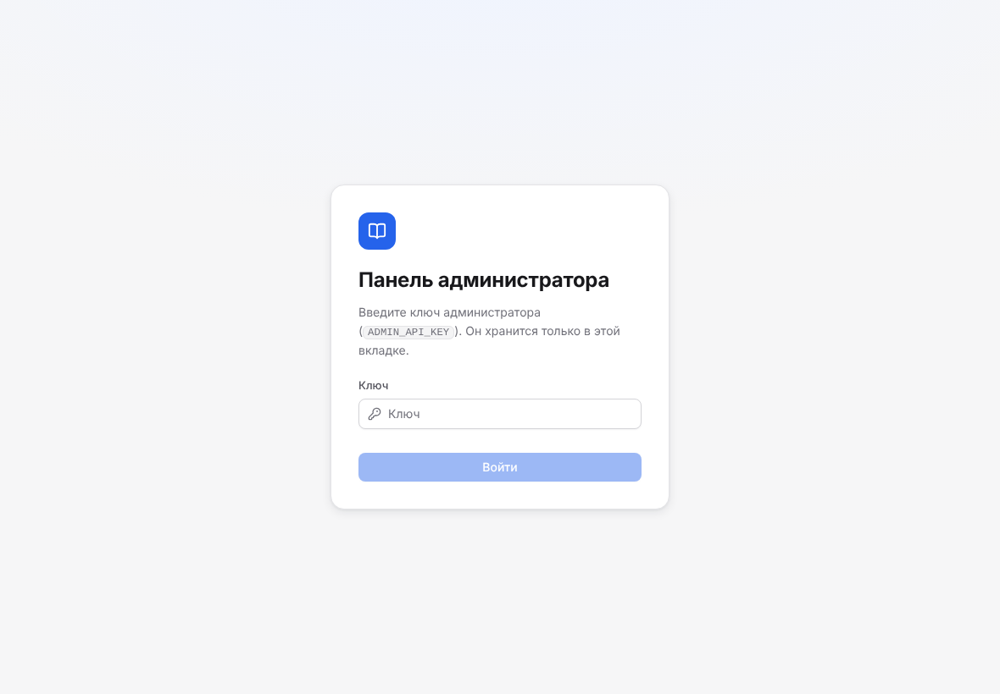
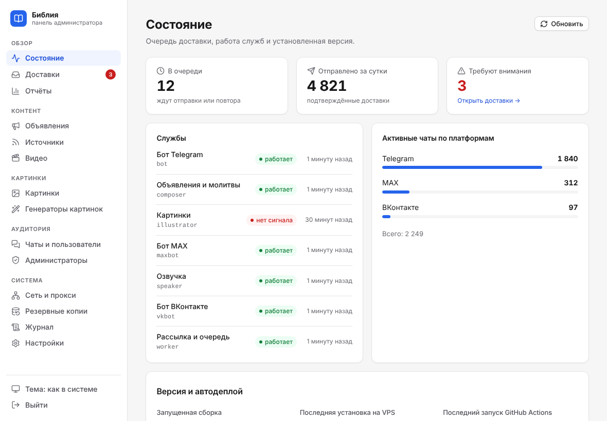
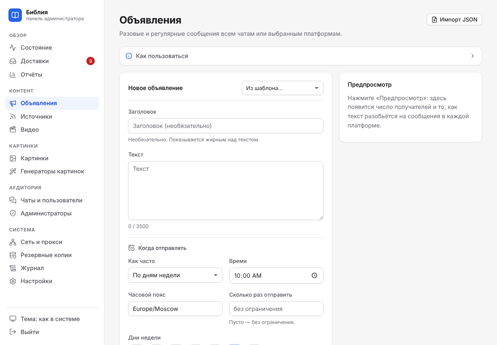
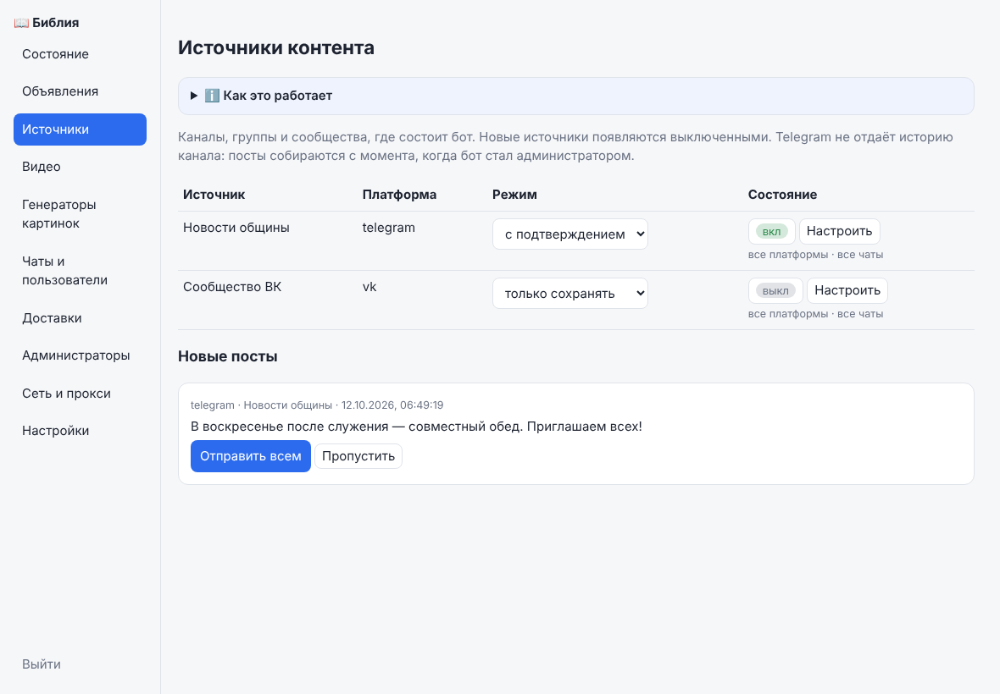
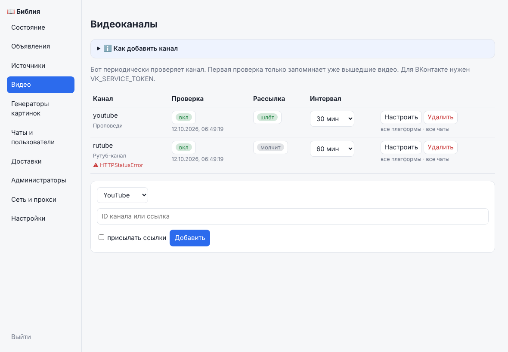
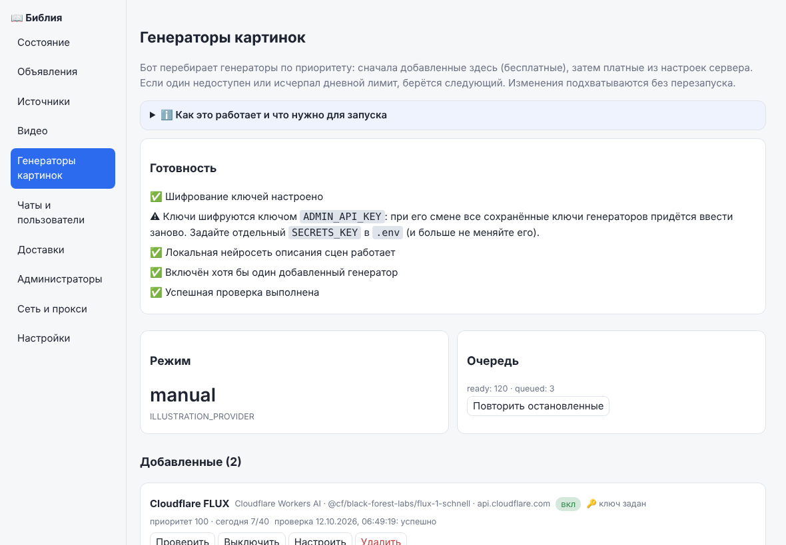
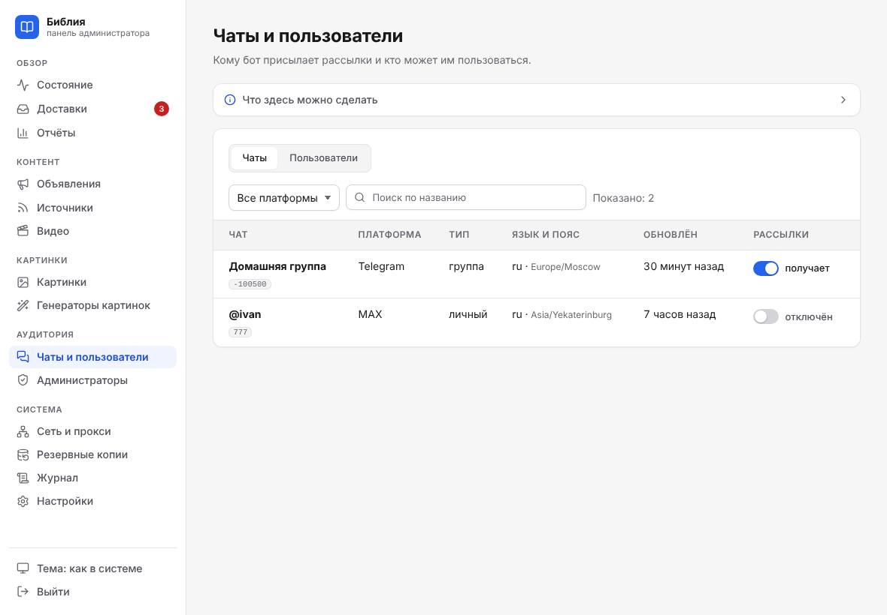
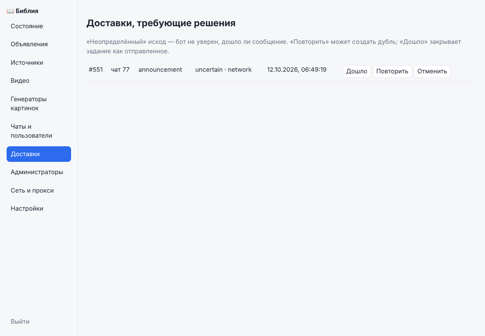
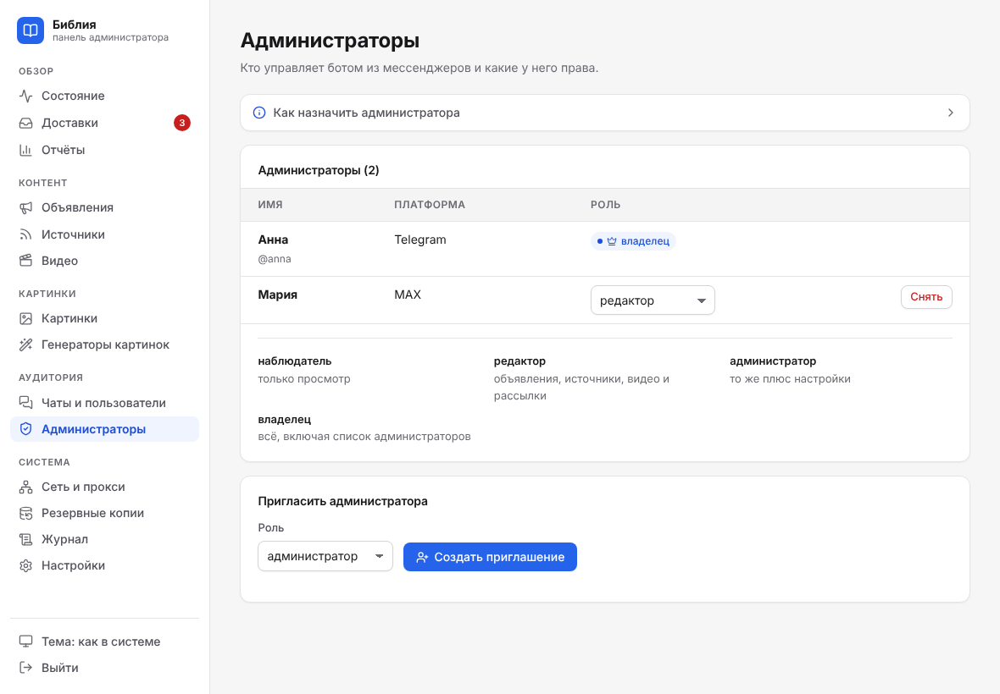
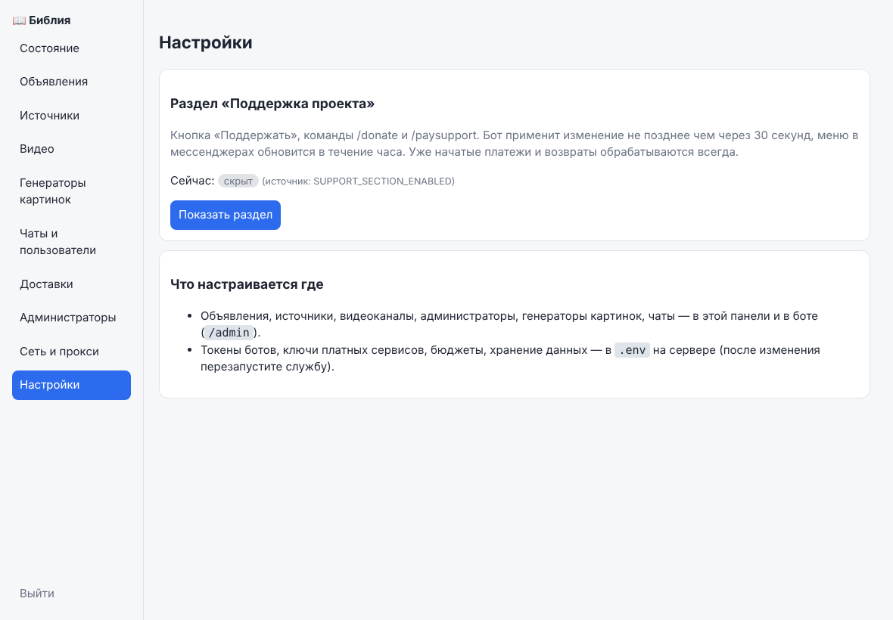

# Панель администратора

Два способа управления: **меню в боте** (`/admin`, во всех мессенджерах) и **веб-панель на React** (`/panel/`). Всё, что доступно в боте, доступно и в панели; в панели есть ещё формы, которые неудобно вводить в чате.

## Вход

1. Панель слушает только `127.0.0.1:8080` на сервере. Откройте SSH-туннель: `ssh -L 8080:127.0.0.1:8080 user@сервер`.
2. Откройте `http://127.0.0.1:8080/panel/`.
3. Введите ключ `ADMIN_API_KEY` из `.env` (не короче 24 символов). Ключ хранится только в текущей вкладке (`sessionStorage`) и передаётся заголовком `X-Admin-Key`.

На рабочем сервере панель также доступна по **https://bible.blagodaty.ru/panel/**. Браузер сначала запрашивает HTTP Basic: логин `admin`, пароль — действующий `ADMIN_API_KEY`. Затем тот же ключ вводится в форму панели. Это дополнительный барьер перед публичным интерфейсом; API по-прежнему требует `X-Admin-Key`. Ключи и резервные копии не публикуются в URL. Подробности HTTPS и продления сертификата — [настройка домена](../operations/admin-domain.md).

Публиковать панель в интернет можно только за HTTPS-прокси с ограничением доступа (по IP или дополнительной авторизации): ключ даёт полный доступ.

## Разделы панели

Вверху страницы «Состояние» находится блок **«Версия и автодеплой»**. Он показывает версию,
коммит и дату сборки из самого Docker-образа, последнюю серверную попытку (начало, завершение,
этап, успех, ошибку или откат) и последний запуск GitHub Actions со ссылкой. Git HEAD хоста
не подменяет версию работающего приложения. При локальном запуске без метаданных коммит неизвестен.

Для ботов отдельно показаны проверка после установки (здоровье контейнера и совпадение SHA)
и текущий сигнал процесса за последние 180 секунд. Свежий сигнал не подтверждает доставку
сообщений через внешний API. Не запущенные при установке платформы отмечаются отдельно.
Данные страницы обновляются каждые 30 секунд; GitHub запрашивается не чаще раза в 2 минуты.
При его отказе старый результат помечается как устаревший. Серверная попытка без обновлений
более 90 минут не считается подтверждённо работающей. Время отображается в часовом поясе браузера.

Админка получает только отдельную квитанцию через read-only mount и публичные сведения
GitHub: Docker socket, `.env`, журналы и приватные артефакты ей не передаются. Для сведений
о workflow публичного репозитория GitHub-токен не требуется. При ограничении API локальная
версия и квитанция сервера продолжают отображаться.

| Раздел | Что можно делать |
|---|---|
| **Состояние** | очередь доставки, отправлено за сутки, требующее внимания, чаты по платформам, сигналы жизни служб |
| **Объявления** | создать (один раз, ежедневно, по дням недели, раз в месяц, через интервал), выбрать аудиторию и картинку, править текст и аудиторию, пауза, возобновление, «отправить сейчас», отмена — [подробно](announcements.md) |
| **Источники** | включить источник, выбрать режим, приставку, минимальную длину, аудиторию копий; новые посты — «Отправить всем» или «Пропустить» — [подробно](sources.md) |
| **Видео** | добавить канал YouTube/RuTube/ВКонтакте, включить опрос и рассылку, интервал, шаблон, аудитория — [подробно](video-watch.md) |
| **Генераторы картинок** | добавить бесплатные и совместимые API, проверить, включить/выключить, приоритет и лимит, состояние платных, повторить остановленные задания — [подробно](image-providers.md) |
| **Чаты и пользователи** | список назначений по платформам, отключить/включить чат, заблокировать пользователя |
| **Доставки** | сообщения с неопределённым или неудачным исходом: «дошло», «повторить», «отменить» |
| **Сеть и прокси** | прокси и порядок путей для Telegram, MAX, ВКонтакте, YouTube, RuTube, генераторов; автоматическое переключение — [подробно](network.md) |
| **Резервные копии** | проверенные облачные копии БД: дата снимка и проверки, размер, скачивание расшифрованного `.dump` — [подробно](../operations/s3-backup.md) |
| **Администраторы** | список, приглашение, снятие прав |
| **Настройки** | раздел поддержки; справка о том, что где настраивается |

### Как выглядят разделы

| Объявления | Источники |
|---|---|
|  |  |

| Видеоканалы | Генераторы картинок |
|---|---|
|  |  |

| Чаты и пользователи | Доставки |
|---|---|
|  |  |

| Администраторы | Настройки |
|---|---|
|  |  |

## Что не настраивается в панели

Токены ботов, ключи платных сервисов, бюджеты, сроки хранения, параметры импорта Библии — в `.env` на сервере (после правки пересоздайте службу: `docker compose up -d --no-deps --force-recreate <служба>`). Полный список — [configuration.md](../reference/configuration.md).

## Настройки

**Раздел «Поддержка проекта».** Показывает или скрывает кнопку «Поддержать», команды `/donate` и `/paysupport` и соответствующий текст справки. Переключатель в панели сохраняется в базе и подхватывается ботами не позднее чем через 30 секунд; меню команд в мессенджерах обновится в течение часа. Если в панели значение не менялось, действует `SUPPORT_SECTION_ENABLED` из `.env` (по умолчанию `false`). Обработка уже начатых платежей и возвратов не отключается никогда.

## Меню в боте

`/admin` — объявления, источники, видео, состояние, администраторы. Подробности — [руководство администратора](README.md).

## REST-интерфейс

Префикс `/api/admin`, ключ в заголовке `X-Admin-Key`, ответы JSON без кэша, политика `default-src 'self'`.

| Группа | Маршруты |
|---|---|
| Состояние | `GET /overview` |
| Объявления | `GET/POST /announcements`, `PATCH /announcements/{id}`, `POST /announcements/{id}/status`, `POST /announcements/{id}/run`, `POST /media` (тело — файл PNG/JPEG/WebP) |
| Источники | `GET /sources`, `PATCH /sources/{id}`, `GET /posts`, `POST /posts/{id}/publish`, `POST /posts/{id}/ignore` |
| Видео | `GET/POST /videos`, `PATCH/DELETE /videos/{id}` |
| Генераторы | `GET/POST /image-providers`, `PATCH/DELETE /image-providers/{id}`, `POST /image-providers/{id}/test`, `GET /image-queue`, `POST /image-queue/retry` |
| Настройки | `GET/PUT /settings` |
| Чаты и пользователи | `GET /chats`, `PUT /chats/{id}/active`, `GET /users`, `PUT /users/{id}/blocked` |
| Доставки | `GET /deliveries/attention`, `POST /deliveries/{id}/resolve` |
| Администраторы | `GET /admins`, `POST /admins/invite`, `DELETE /admins/{id}` |
| Сеть | `GET /net`, `POST/PATCH/DELETE /net/proxies`, `POST /net/proxies/{id}/test`, `PUT /net/services/{service}`, `POST /net/services/{service}/probe` |
| Аудитория | `GET /audience?platform=&chat_type=` — сколько получателей |

Ошибки: `401` — неверный ключ, `403`/`404` — нет прав или не найдено, `409` — не выполнено условие (например, не задан владелец или ключ шифрования), `422` — некорректные данные (в поле `detail` короткий код).

## Сборка панели

В Docker панель собирается автоматически (`node:22` → `app/web/static/panel`). Локально: `cd admin-ui && npm ci && npm run build`; режим разработки: `npm run dev` (прокси на `127.0.0.1:8080`). Если каталог сборки отсутствует, `/panel` не подключается, остальное работает.

## Роли, журнал, отчёты, шаблоны

| Роль | Что может |
|---|---|
| Наблюдатель (`viewer`) | Открывать меню `/admin`, смотреть состояние и список администраторов. Менять ничего не может. |
| Редактор (`editor`) | Объявления, источники, видео, рассылка найденного стиха (`/announce`, `/post`, `/video`). |
| Администратор (`admin`) | То же, что редактор; настройки панели. |
| Владелец | Всё, включая приглашения и снятие администраторов. |

Роль выбирается при создании приглашения (`/admin invite editor`, кнопки в `/admin` → «Администраторы» или список в панели) и меняется в панели на странице «Администраторы». Панель защищена общим ключом, поэтому проверка ролей действует в командах бота.

- **Журнал** (страница «Журнал»): кто, откуда (панель/бот), что и над чем сделал; ключи, пароли и адреса прокси скрываются; хранится 365 дней (`RETENTION_AUDIT_DAYS`).
- **Отчёты** (страница «Отчёты»): доставки по дням и видам, частые ошибки, итоги каждого запуска объявления (получателей, в очереди, доставлено, ошибок).
- **Объявления**: кнопка «Предпросмотр» показывает текст на каждой платформе и число получателей; «Шаблон…» подставляет сохранённый текст, «Сохранить как шаблон» добавляет новый; импорт JSON — список объявлений в формате API (`POST /api/admin/announcements/import`, принимается всё или ничего).
- **Картинки** (страница «Картинки»): режим выбора генератора (по приоритету или автоматически по статистике), общий стиль, галерея с закреплением лучшей версии и карантином неудачных.
