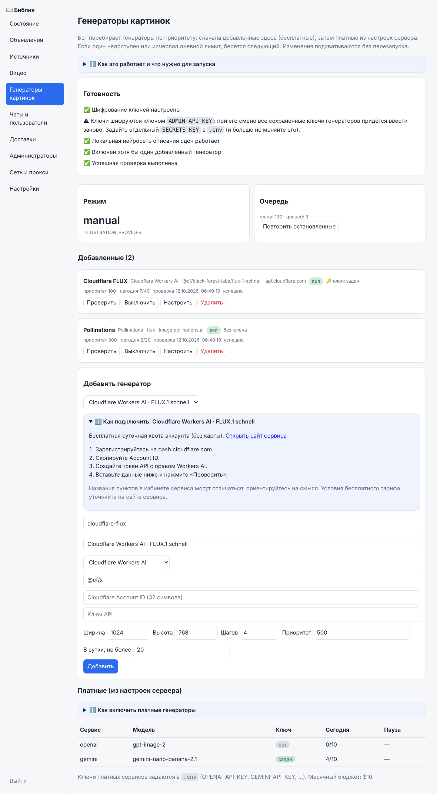

# Генераторы картинок

Бот перебирает генераторы по приоритету. Есть два вида:

| Вид | Где настраивается | Стоимость |
|---|---|---|
| **Платные встроенные** — OpenAI, Google Gemini, FLUX (BFL), Ideogram, Stability AI | ключи в `.env` | резерв из месячного бюджета |
| **Добавляемые в панели** — анонимные сервисы, бесплатные кредиты и совместимые API | веб-панель → «Генераторы картинок» | явная верхняя граница стоимости; ноль только для анонимных стандартных Horde/Pollinations без ключа |

Порядок выбора: сначала добавленные в панели (по числу «приоритет», меньше — раньше), затем платные встроенные. Если генератор недоступен, исчерпал дневной лимит или вернул ошибку, берётся следующий. Новые генераторы подхватываются **без перезапуска** в течение 10 секунд.

В режиме «Автоматически» оценка успешности, брака и скорости действует на **все** генераторы, включая встроенные; при равной оценке решает приоритет.

### Стоимость и общий бюджет

Новый генератор имеет режим `unknown`: до указания цены его генерация и кнопка «Проверить» заблокированы. Для платного API или аккаунта с бесплатными кредитами выберите `metered` и укажите консервативную верхнюю границу стоимости **одного запроса** для выбранной модели, размеров и параметров (не менее $0.10). При смене модели/размеров пересмотрите эту сумму и задайте жёсткий лимит расходов в кабинете провайдера. Это внутренний резерв, а не автоматически полученная цена сервиса.

`free_only` разрешён только для анонимного Horde без модели или стандартного Pollinations/FLUX, на штатном адресе, без ключа и дополнительных параметров. Редактирование адреса, модели, ключа или `extra` не позволяет сохранить этот режим для платного endpoint. Наличие бесплатных кредитов Cloudflare/Hugging Face/Together/SiliconFlow не доказывает нулевую стоимость.

Обычная генерация **и проверочные картинки из панели** резервируются до отправки в одной транзакции с общей бюджетной блокировкой. Они делят месячный бюджет и дневной лимит сервиса. При таймауте, ошибке или перезапуске резерв остаётся в истории до конца UTC-месяца: неизвестный результат мог быть оплачен. Проверка не даёт обойти бюджет, даже при одновременном запуске с воркером.

Миграция 040 помечает подходящие старые анонимные настройки `free_only`. Остальные старые генераторы получают `unknown`, пока администратор не задаст стоимость. Их ключи и история сохраняются.

## Бесплатные генераторы из панели

В панели откройте «Генераторы картинок» → «Добавить генератор», выберите шаблон — под ним появится пошаговая инструкция именно для этого сервиса (где взять ключ, что куда вставить). Вверху страницы есть блок «Готовность» с чек-листом: шифрование ключей, локальная нейросеть описания сцен, включённый и проверенный генератор. Нажмите **«Проверить»**: бот сделает пробную картинку и покажет миниатюру.

| Шаблон | Ключ | Что известно об условиях |
|---|---|---|
| Cloudflare Workers AI · FLUX.1 schnell / SDXL Lightning | токен API + Account ID | бесплатная суточная квота аккаунта, карта не нужна |
| Hugging Face · FLUX.1 schnell | токен с правом Inference | ежемесячный бесплатный кредит аккаунта |
| Pollinations · FLUX | не нужен | анонимно примерно 1 запрос в 15 секунд; возможен водяной знак |
| AI Horde | не нужен (или бесплатный ключ) | общий пул волонтёрских GPU; ожидание от секунд до минут |
| Together AI · FLUX.1 schnell Free | ключ | бесплатная модель была временной акцией — проверьте наличие |
| SiliconFlow · FLUX.1 schnell | ключ | бесплатные модели/кредиты для новых аккаунтов — проверьте |
| Другой сервис | ключ | любой API вида `POST {адрес}/images/generations` |

> **Важно.** Условия бесплатных тарифов меняются, а проверить их из среды разработки было нельзя. Поэтому адрес API, модель и размеры в шаблонах — это стартовые значения, их можно изменить в панели без правки кода. Перед включением нажимайте «Проверить», а размер квоты уточняйте на сайте сервиса.



### Поля

| Поле | Назначение |
|---|---|
| Короткое имя | латиница, цифры и дефис; попадает в журнал как `x-имя` |
| Адрес API | только HTTPS, не локальная сеть; для OpenAI-совместимых сервисов, вида `https://api.example.com/v1` |
| Модель | идентификатор модели у сервиса |
| Account ID | только Cloudflare (32 символа) |
| Ширина, высота, шагов | параметры картинки; не все сервисы их учитывают |
| Приоритет | меньше — раньше; платные встроенные идут после 1000 |
| В сутки, не более | лимит попыток за UTC-сутки для этого генератора |
| Оплата | неизвестна / платный API или кредиты / строго анонимный бесплатный сервис |
| Максимальная стоимость запроса, USD | резерв общего месячного бюджета для платных/кредитных аккаунтов |

### Как работает

1. Для каждой картинки бот сначала просит **локальную нейросеть** описать сцену без текста и надписей и отправляет внешнему сервису только это описание — **текст стиха наружу не уходит**. Если описать сцену не удалось, бесплатные генераторы для этого задания пропускаются.
2. Ответ проверяется (формат, размер) и тем же фильтром надписей, что и у платных генераторов.
3. Ошибки: `429` — повтор позже; `401/403` — генератор отключается на сутки; сбой сети или 5xx может иметь неопределённый платный исход, резерв сохраняется.
4. В режиме `ILLUSTRATION_PROVIDER=manual` работают только генераторы из панели; встроенные ключи из `.env` не используются. Для добавленного платного API общий бюджет действует и в этом режиме.

### Галерея и карантин

«+ вариант» создаёт явное задание администратора. Оно попадает в очередь illustrator без подписки и без ожидающего сообщения пользователя; повторное нажатие переиспользует ещё не готовый вариант. Прежние зависшие задания вариантов исправляются миграцией 040.

Карантин проверяется при подборе картинки, подготовке молитвы, постановке поздней правки и повторном использовании Telegram `file_id`, MAX токена или VK вложения. Богатая карточка с уже подготовленной забракованной картинкой отправляет читаемый текст без этой картинки. Поздняя правка Telegram заменяет полное rich-содержимое, MAX передаёт новый массив вложений без изображения, VK явно передаёт пустой `attachment`, когда медиа нужно убрать. API-ошибка правки остаётся ошибкой доставки и не считается успешной заменой. Изолированное фото без текста отклоняется; неизвестный ID не превращается в успешную отправку. Карантин сам по себе не запускает массовую правку исторических сообщений; для замены одобренной версией используется механизм `artwork_repairs`.

### Безопасность ключей

- Ключи хранятся в базе **зашифрованными** (Fernet). Ключ шифрования — `SECRETS_KEY`, а если не задан, берётся из `ADMIN_API_KEY` (не короче 24 символов). Без него сохранить ключ нельзя.
- Если сменить `SECRETS_KEY`/`ADMIN_API_KEY`, сохранённые ключи перестанут расшифровываться — введите их заново (генератор при этом пропускается с записью в журнал).
- Панель никогда не показывает ключ обратно, только «ключ задан». Заменить — ввести новый, удалить — «Удалить ключ».
- Адрес проверяется при сохранении и при каждом запросе: ключ не уйдёт на локальные адреса, перенаправления не выполняются, ссылки на результат скачиваются без ключа.

### Не получается?

| Симптом | Причина и действие |
|---|---|
| «Проверить» → `auth` | неверный или просроченный ключ; для Cloudflare проверьте Account ID |
| `pricing_unknown` / выключена «Проверить» | укажите режим оплаты и верхнюю границу стоимости |
| `monthly_budget` / `daily_limit` | общий месячный или суточный лимит исчерпан; проверка также учитывается |
| `rate_limited` | превышена квота сервиса; уменьшите «В сутки» или подождите |
| `response_invalid` / `no_image` | сервис вернул не картинку; проверьте адрес и модель |
| `remote_timeout` | AI Horde перегружен; повторите позже или повысьте приоритет другим генераторам |
| `secrets_key_missing` | задайте `SECRETS_KEY` или `ADMIN_API_KEY` (24+ символа) и пересоздайте службу admin |
| Задания стоят | панель → «Генераторы картинок» → «Повторить остановленные» |

## Платные генераторы (встроенные)

В режиме `ILLUSTRATION_PROVIDER=auto` бот использует только сервисы с сохранённым ключом. Очерёдность по умолчанию: **OpenAI → Google Gemini → Black Forest Labs → Ideogram → Stability AI**. Отсутствующий ключ пропускается без запроса и расходования лимита. Порядок можно задать через `IMAGE_PROVIDER_ORDER`, перечисляя уникальные имена `openai,gemini,bfl,ideogram,stability`.

Это подбор независимых официальных API для качественных библейских иллюстраций с разумной стоимостью, а не объективный рейтинг качества. У всех сохраняется единый исходный текст, художественный prompt, кэш, PostgreSQL/S3 и обновление всех ожидающих карточек.

| Сервис | Закреплённая модель / режим | Ключ в `.env` | Официальные сведения |
|---|---|---|---|
| OpenAI | GPT Image 2, medium, 1536×1024 | `OPENAI_API_KEY` | [API и ошибки](https://developers.openai.com/api/docs/guides/image-generation) |
| Google Gemini | Nano Banana 2.1, 1K, 3:2 | `GEMINI_API_KEY` | [Изображения](https://ai.google.dev/gemini-api/docs/image-generation), [цены](https://ai.google.dev/gemini-api/docs/pricing) |
| Black Forest Labs | FLUX.2 Pro, закреплённый snapshot, 1536×1024 | `BFL_API_KEY` | [Создание и проверка задания](https://docs.bfl.ai/quick_start/generating_images), [цены](https://bfl.ai/pricing?category=flux.2) |
| Ideogram | Ideogram 4.0, DEFAULT, размер API по умолчанию | `IDEOGRAM_API_KEY` | [API](https://developer.ideogram.ai/v1/api-reference/generate-images/generate-v4), [цены](https://ideogram.ai/api-pricing) |
| Stability AI | Stable Image Ultra, 3:2, JPEG | `STABILITY_API_KEY` | [API](https://platform.stability.ai/docs/api-reference), [цены](https://platform.stability.ai/pricing) |

Параметры и цены сверены по официальным страницам 8 октября 2026. API-доступ и средства оплачиваются отдельно в каждом аккаунте; подписка на пользовательский сайт не обязательно включает API. Ключи не входят в Git, сообщения Telegram или отчёты. Секреты всех пяти сервисов маскируются в журнале.

## Несколько ключей OpenAI

`OPENAI_API_KEY` остаётся основным ключом. Дополнительные ключи изображений задаются приватно через `OPENAI_API_KEYS`, разделяя запятыми; также поддерживается JSON-массив строк. Пустые значения пропускаются, повторы удаляются. Максимум — 32 уникальных ключа вместе с основным. Эти дополнительные ключи не используются для платной озвучки.

```dotenv
OPENAI_API_KEY=YOUR_PRIMARY_PRIVATE_KEY
OPENAI_API_KEYS=YOUR_SECOND_PRIVATE_KEY,YOUR_THIRD_PRIVATE_KEY
IMAGE_OPENAI_DAILY_SCOPE=provider
```

Внутри OpenAI выбирается доступный ключ с наименьшим числом попыток сегодня. При одинаковом числе используется порядок конфигурации. После отказа одного ключа следующее задание/обход может использовать другой; другие сервисы сохраняют заданный приоритет. Блокировки хранятся отдельно по SHA-256 ключа, сами ключи в БД не записываются. Удаление/возврат ключа и перезапуск не сбрасывают его блокировку, историю попыток или бюджет. Успех второго ключа не снимает ошибку первого.

`IMAGE_OPENAI_DAILY_SCOPE=provider` по умолчанию сохраняет общий лимит OpenAI, независимо от числа ключей. Явный режим `key` применяет `IMAGE_DAILY_MAX_REQUESTS` к каждому ключу OpenAI; лимиты других сервисов остаются прежними. Общий месячный резерв не меняется ни в одном режиме. Дополнительные ключи одного проекта/организации могут делить [лимиты OpenAI](https://developers.openai.com/api/docs/guides/rate-limits); они не создают независимый баланс автоматически.

После изменения списка пересоздайте illustrator. Команда диагностики ниже показывает номера ключей, их попытки, паузы и ошибки, не раскрывая ключи или их отпечатки. При настройке только OpenAI (`ILLUSTRATION_PROVIDER=openai`) пул также работает, другие сервисы не выбираются.

Если старые попытки OpenAI не содержат отпечатка ключа, в режиме `key` они консервативно учитываются у каждого ключа до конца текущих UTC-суток. Их принадлежность не определяется по догадке и история не переписывается. Диагностика показывает их отдельно как `unassigned_daily_requests`.

## Ошибки и ожидание

- Авторизация/исчерпанный баланс: конкретный ключ пропускается на 24 часа; остальные ключи и сервисы работают. Новый ключ получает отдельное состояние; блокировка прежнего сохраняется. Коды исчерпания кредитов и лимитов проекта/организации классифицируются как квота, отдельно от временного ограничения частоты. [Ошибки OpenAI](https://developers.openai.com/api/docs/guides/error-codes).
- Ограничение частоты: выдерживается `Retry-After`; без него пауза минимум 60 секунд. Пока сервис на паузе, используется следующий.
- Ошибка сервера, потерянный/непригодный ответ: попытка помечается `uncertain`, её резерв сохраняется; другой провайдер может принять следующее задание для той же картинки. Повторной отправки того же prompt тому же провайдеру с тем же ключом в этом задании нет.
- **Тайм-аут не доказывает отсутствие оплаты. Переключение может оплатить две генерации.** Обе попытки учтены в лимите; бот не обнуляет резерв по неизвестному результату. Это поведение нового режима `auto`. Старые задания, уже помеченные `uncertain` до обновления, и ошибки сохранения результата автоматически не возобновляются.
- FLUX сначала возвращает ID и `polling_url`: они сохраняются до ожидания картинки. Проверки статуса не являются новыми платными генерациями. После перезапуска проверяется тот же ID. При отсутствии результата 15 минут попытка остаётся неопределённой и выбирается следующий сервис; поздний результат этой попытки автоматически уже не забирается.
- Не более одной платной отправки на одну пару провайдер/ключ в задании. Общий предел отправок — максимум из пяти и числа подключённых пар (до 36: 32 OpenAI и четыре других сервиса), с сохранением суточных/месячных ограничений. После исчерпания цепочки задание завершается с ошибкой; текстовая карточка остаётся читаемой. Это не бесконечный цикл оплаты.
- Отказ модерации завершает задание; цепочка не используется для обхода отказа. Длинный prompt передаётся целиком; если API отвергает его размер, следующий сервис получает тот же полный источник.

Обычная смена сервиса происходит на следующем обходе illustrator, обычно через 10 секунд после полученного отказа. Синхронный запрос ограничен тайм-аутом HTTP 240 секунд; медленный генератор не блокирует отдельные процессы bot/worker и отправку текста. Проверки FLUX выполняются раз в 30 секунд.

Загрузка готового файла ограничена 20 MiB и 9 миллионами пикселей. PNG/JPEG/WebP проверяются до сохранения. Файл больше 5 MiB преобразуется в JPEG с сохранением разрешения и ограничением итогового размера 5 MiB; это локальная обработка готового ответа, без повторной оплаты генерации.

## Суточные лимиты и общий месячный бюджет

**По 10 новых API-попыток в UTC-сутки для каждого провайдера; $10 внутреннего месячного резерва суммарно на все сервисы.** `IMAGE_DAILY_MAX_REQUESTS=10` задаёт лимит каждого сервиса, а `IMAGE_MONTHLY_BUDGET_USD=10` — общий предел. При пяти подключённых сервисах теоретически доступны 50 попыток в сутки, пока хватает месячного резерва; при двух — 20. Прежние попытки OpenAI уже относятся к его счётчику. Смена ключа не сбрасывает суточный лимит. Отсчёт суток начинается в 00:00 UTC (07:00 в Новосибирске). Резерв каждой отправки: OpenAI/FLUX/Ideogram/Stability — $0.10, Gemini — $0.40 для полного ограниченного prompt и максимум 4096 выходных токенов. Отказы и неизвестные результаты тоже учитываются. Эти консервативные значения не являются фактическим тарифом или счётом провайдера; реальная стоимость зависит от API и его изменений.

Резерв проверяется транзакцией с общей блокировкой PostgreSQL до каждого нового запроса. Исчерпавший свой суточный лимит сервис пропускается; выбирается следующий с ключом, свободными попытками и без активной паузы. Если все сервисы исчерпаны, задание остаётся в очереди до следующих UTC-суток. Переключение не обходит общий месячный предел. Принятое FLUX-задание может проверяться после исчерпания лимита: повторной оплаты нет. Расписания и старые картинки сохраняются.

## Подключение и диагностика

1. Создайте ключи в собственных кабинетах: [Google AI Studio](https://aistudio.google.com/apikey), [BFL](https://dashboard.bfl.ai/), [Ideogram](https://ideogram.ai/manage-api), [Stability](https://platform.stability.ai/account/keys). При необходимости подключите API-биллинг/кредиты.
2. В приватном `.env` заполните нужные ключи и `ILLUSTRATION_PROVIDER=auto`; задайте лимит каждого сервиса `IMAGE_DAILY_MAX_REQUESTS=10` и общий месячный предел `IMAGE_MONTHLY_BUDGET_USD=10`.
3. При обновлении до 1.14.0 после backup остановите службы приложения и примените миграции, включая 015 (`python -m app.cli seed` внутри bootstrap), затем запустите новую версию. Миграция сохраняет существующие блокировки и платную историю, меняя ключ таблицы состояния на пару провайдер/отпечаток. При последующем добавлении ключей достаточно пересоздать illustrator: `docker compose up -d --no-deps --force-recreate illustrator`.
4. Проверьте состояние без раскрытия ключей:

```bash
docker compose exec -T illustrator python -m app.illustrations_admin providers
```

Команда показывает наличие ключа, порядок, модель, паузу/ошибку, использованные/оставшиеся попытки каждого сервиса и общий месячный резерв. Она не запускает платную генерацию. Наличие ключа не доказывает действующий баланс или качество результата. Адаптерные тесты не заменяют живую проверку каждого подключённого аккаунта.

[Постоянные карточки](../features/persistent-artwork.md), [проверки выпуска](../../RELEASE-AUDIT.md).
