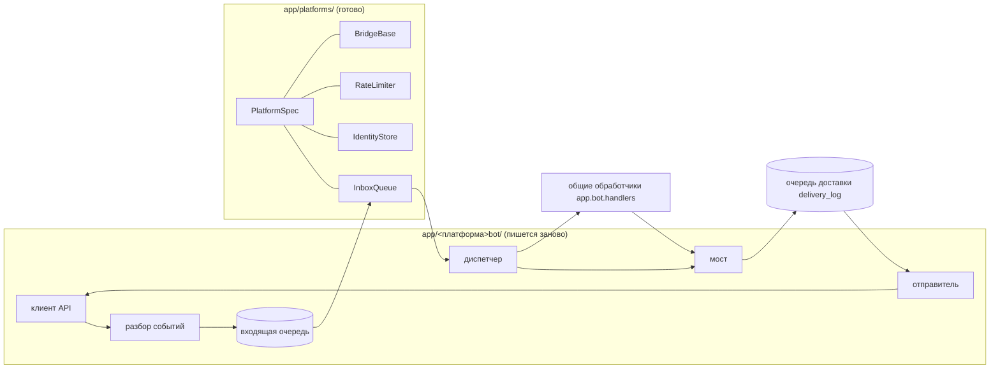

# Как добавить новый мессенджер

Все платформы, кроме Telegram, подключаются через **мост**: общие обработчики команд написаны под aiogram, а мост подставляет вместо `Bot` объект с теми же методами и ставит ответы в общую очередь доставки. Общий каркас лежит в `app/platforms/`; для MAX и ВКонтакте он уже используется. Код очереди событий, идентификаторов, ограничителя скорости и моста **не копируется**.

## Что уже есть и что нужно написать

| Что | Где | Нужно ли писать |
|---|---|---|
| Описание платформы (имя, таблицы, лимиты, разбиение текста) | `app/platforms/builtin.py` | одна запись `PlatformSpec` |
| Сопоставление внешних ID внутренним | `app/platforms/identities.py` | нет — `IdentityStore(spec)` |
| Входящая очередь событий, порядок в чате, восстановление | `app/platforms/inbox.py` | нет — `InboxQueue(spec)` |
| Ограничитель скорости | `app/platforms/rate_limit.py` | нет — `RateLimiter(spec)` |
| Ключи идемпотентности ответов, постановка ответов в очередь | `app/platforms/bridge.py` | наследовать `BridgeBase` и задать 3 метода |
| Маршруты и прокси | `app/net/` | нет — клиент создаётся с `SmartTransport('<сервис>')` |
| Клиент API платформы | `app/<платформа>bot/client.py` | **да** |
| Разбор и проверка событий | `app/<платформа>bot/events.py` | **да** |
| Кнопки (из клавиатуры Telegram в формат платформы) | `app/<платформа>bot/ui.py` | **да** |
| Диспетчер событий (сообщение → команда, нажатие → действие) | `app/<платформа>bot/dispatcher.py` | **да** |
| Отправитель (части очереди → вызовы API) | `app/<платформа>bot/transport.py` | **да** |
| Служба (получение событий, heartbeat) | `app/<платформа>bot/main.py` | **да** |

## Шаги

1. **Миграция.** Добавьте платформу в проверки `platform IN (...)` таблиц `telegram_users`, `telegram_chats`, `reading_cards`, `platform_identities`, `usage_events`, `content_sources`; создайте таблицы `<имя>_inbox` и `<имя>_rate_limits` (образец — миграция 029 для ВКонтакте). Не забудьте правила очистки в `app/maintenance.py`.
2. **Описание.** В `app/platforms/builtin.py` зарегистрируйте `PlatformSpec(...)`: имя, название, имя службы, таблицы, интервалы ограничителя, функция разбиения текста и вид части (`chunk_kind`).
3. **Клиент.** `app/<имя>bot/client.py`: класс с `call()`, отправкой, правкой и загрузкой файлов. Внутренний HTTP-клиент создавайте так: `transport=transport or SmartTransport('<сервис>')` — тогда прокси и автопереключение заработают без дополнительного кода. Добавьте сервис в `app/net/services.py` (ключ, название, адрес проверки, окончания хостов).
4. **События.** `events.py`: проверка формы, ключ дедупликации, запись в `<имя>_inbox` (в одной транзакции до подтверждения источнику).
5. **Мост.** Унаследуйте `BridgeBase`, задайте `spec`, и реализуйте `sender()`, `get_me()`, `get_chat()`, `get_chat_member()`, `__call__()` (подтверждение нажатия), `attach_keyboard()`, `welcome_chunk()`.
6. **Отправитель.** `transport.py`: принимает часть очереди (`dict` вида вашего `chunk_kind`, карточки `rich`/`rich_edit`, `photo`, `asset_photo`) и вызывает API; ошибки превращайте в `SendError('retry' | 'forbidden' | 'uncertain' | 'rejected')`. Правило: сетевая ошибка при **новой** отправке — `uncertain`, при правке — `retry`.
7. **Диспетчер.** Событие → `message_new` для общих обработчиков (`handlers.command_handler`, `callback_handler`, `message_language_handler`). Команды управления группами — по образцу `chat:<ID>`.
8. **Подключение к доставке.** В `PlatformTransports` (`app/services/platform_sender.py`) добавьте метод `<имя>_sender(connection)` — `DestinationSender` находит его по имени платформы сам.
9. **Служба.** `main.py` по образцу `vkbot/main.py` (singleton-блокировка, `InboxQueue.consumer_loop`, `features.refresh_loop`, `net_store.refresh_loop`, heartbeat); запись в `docker-compose.yml` с профилем; имя службы в `app/healthcheck.py`.
10. **Тесты.** Образец — `tests/test_vk_client.py` (клиент без сети) и `tests/test_vk_bridge_postgres.py` (весь путь с имитацией API).
11. **Документация.** `docs/platforms/<имя>.md` и строка в `docs/platforms/README.md`.

## Что получаете бесплатно

Объявления, рассылка стиха, источники контента, слежение за видео, администраторы по коду приглашения, панель, метрики, маршруты и прокси, постраничные настройки — всё это работает для новой платформы после шагов 1–9, потому что оно написано поверх общих сервисов (`fanout`, `delivery_log`, `platforms`), а не поверх конкретного мессенджера.
