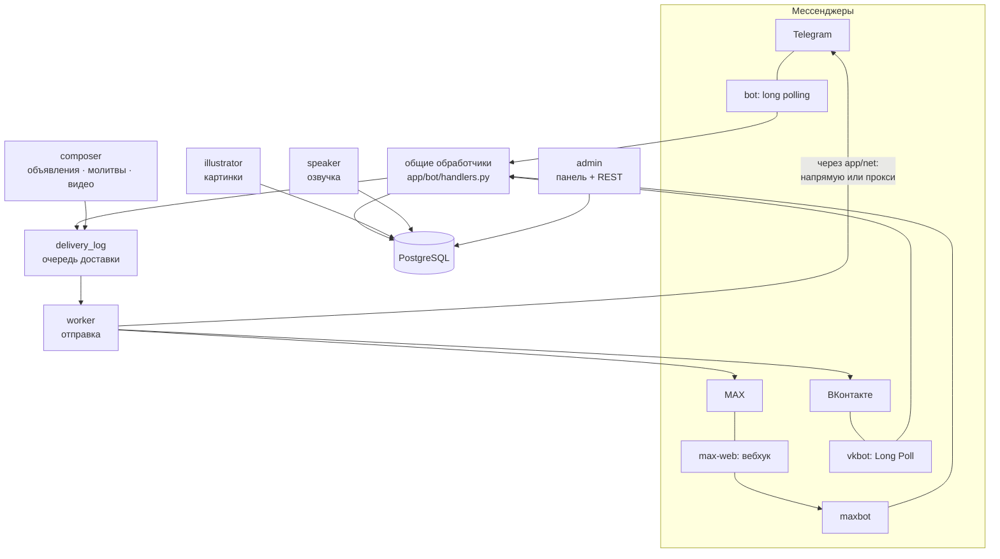

# Как устроены системы: подробно

Документ описывает каждую подсистему: что она делает, из каких частей состоит, как работает и где в коде искать. Для общей схемы служб см. [architecture.md](../reference/architecture.md).

## 1. Общая схема

| Служба | Что делает |
|---|---|
| `bot` | принимает события Telegram (long polling), обновляет профиль бота, сверяет платежи |
| `maxbot`, `max-web` | MAX: вебхук пишет события в очередь, потребитель обрабатывает их |
| `vkbot` | ВКонтакте: Long Poll → очередь → потребитель |
| `worker` | единственный отправитель: берёт задания из `delivery_log`, соблюдает лимиты, делает повторы |
| `composer` | раз в 10 секунд: готовит молитвы, запускает объявления, опрашивает видеоканалы |
| `illustrator` | генерирует картинки через цепочку генераторов, зеркалирует их в S3 |
| `speaker` | создаёт озвучку чтений |
| `admin` | веб-панель `/panel/`, REST `/api/admin/*`, `/metrics`, `/ready` |
| `postgres`, `bootstrap` | база и подготовка (миграции, импорт Библии, аудит) |
| `prayer-ai` (профиль `prayers`) | локальная нейросеть: сцены для картинок и прошения молитв |
| `backup`, `alerts`, `housekeeping` (профиль `maintenance`) | копии, оповещения, очистка |

Принцип: **любое сообщение пользователям сначала записывается в базу, и только потом отправляется**. Службы не общаются друг с другом напрямую — они общаются через таблицы. Поэтому падение любой службы не теряет данных, а перезапуск не дублирует сообщения.

## 2. Приём событий и ответы (Telegram, MAX, ВКонтакте)

Три платформы приходят к одним и тем же обработчикам (`app/bot/handlers.py`, `dispatch.py`):

- **Telegram** — aiogram напрямую; сессия `RoutedSession` выбирает маршрут (см. §14).
- **MAX** — вебхук `max-web` проверяет секрет и записывает событие в `max_inbox` **до** ответа «принято»; `maxbot` обрабатывает события: в одном чате строго по порядку, до 4 чатов параллельно.
- **ВКонтакте** — `vkbot` получает события Long Poll и в одной транзакции пишет их в `vk_inbox`; позиция `ts` сдвигается только после успешной записи, дубли отбрасываются по `event_id`.

Для MAX и ВКонтакте работает **мост** (`app/platforms/bridge.py`): он притворяется ботом aiogram (`get_chat`, `get_chat_member`, подтверждение нажатия), поэтому команды, кнопки и права проверяются одним и тем же кодом. Ответ ставится в очередь доставки с ключом `<платформа>-event:<событие>:reply:<номер>` — повторная обработка того же события не создаёт второго сообщения.

Если обработчик упал неожиданно, событие получает статус `uncertain` и **не повторяется автоматически** (эффекты могли уже сохраниться); при старте потребитель помечает прерванные события так же.

Внутренние идентификаторы: пользователи и чаты MAX/VK получают собственные числа из отдельной последовательности (`platform_identities`), поэтому совпадение с Telegram ID ничего не объединяет. У личного чата внутренний ID совпадает с ID пользователя (так работает общая проверка прав).

## 3. Очередь доставки (`delivery_log`)

Один механизм для всего: чтения по подпискам, ответы на команды, объявления, рассылка стиха, копии постов, ссылки на видео, молитвы.

- Задание = чат + ключ (`UNIQUE(чат, ключ)`) + список частей (`chunks`) + прогресс (`next_chunk`). Повторная постановка с тем же ключом ничего не дублирует.
- `worker` берёт задание под блокировкой чата, отправляет часть за частью и после **подтверждения** каждой части сохраняет прогресс. Подписка и «следующий запуск» сдвигаются только после полной отправки.
- Результат отправки (`SendError`): `retry` (повтор с нарастающей паузой), `forbidden` (чат отключается, подписки приостанавливаются), `uncertain` (неясно, дошло ли: задание ждёт решения человека — «дошло / повторить / отменить» в панели или `/resolve`), `rejected` (окончательный отказ).
- Ограничитель скорости каждой платформы хранится в БД и общий для всех процессов.
- Режимы `broadcast`, `announcement`, `source_post`, `video_notice` не отменяются при смене настроек чата.

## 4. Библия, чтение и поиск

Тексты хранятся в `verses` (издание, книга, глава, стих). Импорт (`bootstrap`) берёт три источника (BibleNLP/eBible, getBible, HelloAO), проверяет лицензию и структуру, ведёт кэш с SHA-256. Бот работает только с сохранённым корпусом. Адрес (`Ин 3:16`, `Пс 22`, `1 Кор 13:4–8`) разбирается `app/services/passage.py`: отсутствующий стих — ошибка, другой стих не подставляется. Читаемые отрывки стиха дня собираются с контекстом (`readings.py`). Кнопки языков под сообщением переключают издание в том же сообщении (`message_languages.py`).

## 5. Подписки, время и молитвы

Подписка = чат + режим (`verse`, `sequential`, `reading_plan`, утро/вечер) + время + часовой пояс + `next_run_at`. `worker.scheduler` готовит задания заранее (картинка и озвучка собираются до отправки, `prepared_schedules`), отправляет в нужную минуту и сдвигает `next_run_at` по часовому поясу чата. Молитва формируется `composer` из сегодняшних новостей ООН (окно 18 часов) локальной нейросетью; при её недоступности темы подбираются по ключевым словам, формулировки меняются по дате.

## 6. Иллюстрации

- **Что иллюстрируется:** один стих, целая глава, **диапазон стихов** (своя картинка на точную последовательность) — [правила](../features/illustrations.md).
- **Ключ картинки:** издание + книга + глава + стих (+ последний стих для диапазона) + SHA-256 текста. Изменился текст — это другая картинка. Свежесть три календарных месяца, архив версий чередуется между пользователями.
- **Ожидание:** текст приходит сразу, картинка добавляется **правкой того же сообщения**, когда готова (`illustration_requests`), даже через недели.
- **Генерация (`illustrator`)** — цепочка генераторов `app/services/image_router.py`:
  - `providers()` собирает платные (по ключам из `.env`) и добавленные в панели;
  - порядок: добавленные по `priority` (меньше — раньше), затем платные;
  - `reserve()` атомарно выбирает провайдера: учитывает уже пробованных для задания, суточные лимиты, паузы после ошибок и месячный бюджет платных; резерв записывается до отправки;
  - внешним сервисам отправляется **описание сцены** от локальной нейросети (для платных OpenAI/Gemini/BFL/Ideogram — полный запрос; для Stability и всех добавленных — только описание сцены), текст стиха наружу не уходит;
  - результат проверяется OCR-фильтром надписей; неясный сбой платного запроса не повторяется (риск двойной оплаты);
  - адаптеры добавленных генераторов — `app/services/free_image_providers.py` (Cloudflare, Hugging Face, Pollinations, AI Horde, OpenAI-совместимые).

## 7. Озвучка

`speaker` создаёт аудио выбранного языка и голоса (русские «Давид» и «Мария», локальные модели, платные — по лимитам), кэширует по тексту и языку. Telegram и MAX получают аудио вложением; **ВКонтакте — настоящим голосовым сообщением**: MP3 перекодируется ffmpeg в OGG/Opus и загружается как `audio_message` (при сбое ffmpeg — запасной вариант, обычный файл).

## 8. Объявления

`announcements` + `announcement_runs`. Расписание: один раз / ежедневно / по дням недели / раз в месяц / через интервал, часовой пояс, число повторов, дата окончания. `composer` каждые 10 секунд:

1. дорассылает «зависшие» запуски (до 5 попыток, затем `failed`); один сломанный запуск остальные не блокирует;
2. берёт наступившие объявления (`FOR UPDATE SKIP LOCKED`), записывает запуск (`UNIQUE(объявление, момент)`), сдвигает расписание и ставит рассылку в очередь с ключом `announcement:<запуск>`.

Опоздавший больше чем на `misfire_grace_minutes` (60) запуск пропускается (`skipped_late`), а не высылается пачкой. Пауза/возобновление пересчитывают ближайший запуск, не теряя предстоящий. Локальное время, не существующее из-за перехода на летнее время, сдвигается на следующий день.

## 9. Рассылка найденного стиха

Администратор находит стих (`/read`, `/search`…) → под результатом кнопка «Отправить всем» → подтверждение с числом получателей → `broadcasts` (`draft → sending → done`) → для каждого активного чата строится текст **в издании этого чата** и ставится задание `broadcast:<номер>`. Картинка и озвучка — те же, что созданы при поиске администратора: одна на всех.

## 10. Источники контента (каналы и группы)

События каналов/групп поступают из трёх мест: Telegram (`channel_post`, сообщения групп), MAX (сообщения групп), ВКонтакте (`wall_post_new`, беседы). `chat_sources.ingest_post` регистрирует источник **выключенным**; для включённого сохраняет пост (`UNIQUE(источник, ID поста)`) и по режиму: `capture` — только хранит, `approve` — уведомляет администраторов (`/post ID`), `auto` — сразу ставит копии в очередь (исходный чат исключается). Картинки скачиваются только по HTTPS, без редиректов, не из частных сетей: проверяется и адрес, и все IP, в которые он превращается. Если рассылка не поставилась, пост возвращается в «новые».

## 11. Слежение за видео

`video_feeds`/`video_items`. `composer` «захватывает» наступившие каналы (сдвигает `next_check_at` на 10 минут, так что вторая копия службы их не берёт), затем для каждого канала отдельно: загрузка (YouTube RSS, RuTube JSON, VK `video.get`) → разбор → запись. Первый опрос только запоминает видео. Новое видео записывается один раз; уведомление идёт с ключом `video:<id>`; не более 3 за опрос; видео старше создания канала (вернулось в окно ленты) не рассылается. Сбой канала записывается в его состояние с растущей паузой до 6 часов и не влияет на остальные.

## 12. Администрирование

- **Роли:** владелец (`OWNER_CLAIM_CODE`, один раз), администраторы по одноразовому коду-приглашению (`/claim КОД`, на любой платформе, срок 24 часа, хранится только хеш).
- **Меню `/admin`** в боте и **веб-панель** `/panel/` (React, `admin-ui/`) используют одни и те же сервисы.
- **REST** `/api/admin/*`: ключ `X-Admin-Key`, сравнение за постоянное время, значения в SQL только через параметры, ключи внешних сервисов и адреса прокси наружу не отдаются.
- **Секреты в базе** шифруются (`secrets_box`, Fernet; `SECRETS_KEY` либо `ADMIN_API_KEY`).
- **Переключатели разделов** (`features`): значение из панели читается службами раз в 30 секунд.

## 13. Платформенный каркас

`app/platforms/`: `PlatformSpec` (описание), `IdentityStore`, `InboxQueue`, `RateLimiter`, `BridgeBase`. Новая платформа = одна запись `PlatformSpec` + клиент, события, кнопки, диспетчер, отправитель, служба — [инструкция](new-platform.md). Дублирования кода очереди, идентификаторов, ограничителя и моста между MAX и ВКонтакте нет: оба берут общие классы. Платформенно-зависимые части (клиент API, формат событий, кнопки, диспетчер, отправитель) у MAX и VK различаются по сути и написаны отдельно.

## 14. Сеть: маршруты и прокси

`app/net/`: `Router` (политики и здоровье путей), `SmartTransport` (httpx), `RoutedSession` (aiogram), `store` (загрузка из БД, снимок здоровья). Каждый запрос идёт по лучшему пути сервиса; при ошибке соединения пробуется следующий; путь с серией неудач временно отключается («автомат»). Подробно — [network.md](../admin/network.md).

## 15. Хранение, копии, мониторинг

PostgreSQL 16 — единственное хранилище (картинки и озвучка в `bytea`); зашифрованные копии БД и копии картинок в S3; `/metrics` (Prometheus) и оповещения владельцу (зависшие доставки, молчащие службы, бюджет, опоздавшие объявления, сбои видеоканалов, очередь VK); автоматическая очистка устаревших строк (`housekeeping`). [Мониторинг](../operations/monitoring.md).

## 16. Безопасность (кратко)

Секреты только в `.env` и в зашифрованном виде в БД; проверка прав при каждом нажатии; защита от SSRF для всех загрузок по внешним адресам; XML без DOCTYPE; без редиректов в клиентах API; ограничения размера ответов; журналы без текстов сообщений и ключей. [Подробно](../operations/security.md).
